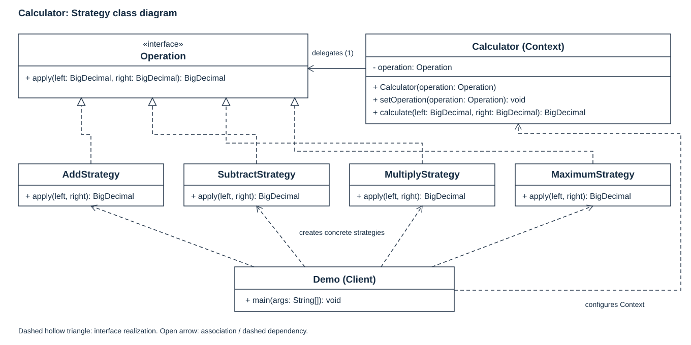
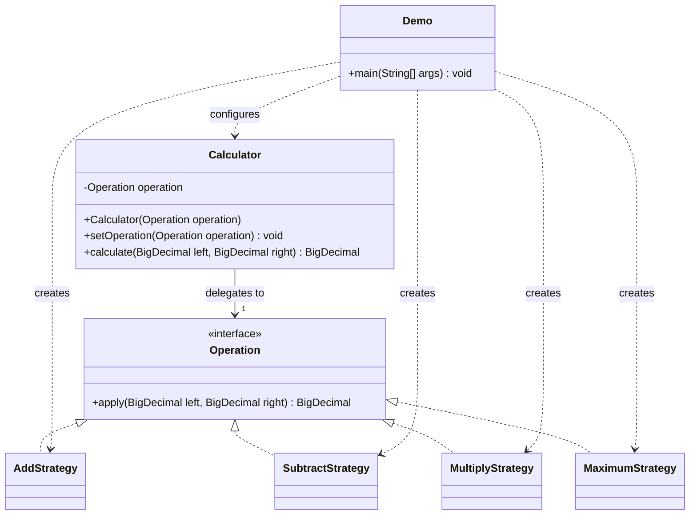

# Assignment 5 - Strategy Pattern

Nurdaulet Mukhitden | SE-2537 | Option B: Calculator

Study reference prepared with AI assistance on 25 October 2026. This example and
reflection are learning materials, not a claim of independent student authorship.

## 1. Introduction

The example calculates a result from two decimal operands. Addition, subtraction
and multiplication form a family of interchangeable algorithms. Each implements
`Operation`; `Calculator` stores that interface and delegates the calculation.
`Demo` selects the strategy and replaces it on the same context at runtime.
`MaximumStrategy` demonstrates a later extension.

`BigDecimal` values are constructed from strings, for example `"0.1"`, and the
three arithmetic strategies use its exact operations. The program has no division
or implicit rounding behavior. The [Java 17 BigDecimal documentation](https://docs.oracle.com/en/java/javase/17/docs/api/java.base/java/math/BigDecimal.html)
describes these numeric semantics.

## 2. UML class diagram



The following editable diagram is included so the structure remains available in
Markdown viewers without SVG previews:



The arrow from the context is an association, not ownership of a strategy's
lifetime: a client may supply an implementation created elsewhere. Each
realization arrow connects a concrete strategy to the shared interface.

## 3. Clean Code

### 3.1 Replace operation selection branches with polymorphism

The context delegates through the interface:

```java
return operation.apply(left, right);
```

This is the final statement of `Calculator.calculate`. No `if`, `switch` or
`instanceof` selects an algorithm there. The context therefore needs no new branch
when another implementation is added. Null validation is a separate input concern.

### 3.2 Use names that reveal intent

```java
calculator.setOperation(new SubtractStrategy());
printResult("Subtraction", calculator, left, right);
```

These lines from `Demo` state which operation the client wants. Names such as
`left`, `right` and `calculate` describe the calculation without requiring the
reader to decode numeric operation identifiers.

### 3.3 Give each strategy a single responsibility

```java
public final class MultiplyStrategy implements Operation {
    @Override
    public BigDecimal apply(BigDecimal left, BigDecimal right) {
        return left.multiply(right);
    }
}
```

This class performs multiplication. It does not read console input, print results,
or change the context. Printing belongs to `Demo`, and strategy selection belongs
to its client code.

### 3.4 Depend on the algorithm contract

```java
private Operation operation;

public Calculator(Operation operation) {
    setOperation(operation);
}
```

`Calculator` knows only `Operation`. It does not import or construct concrete
strategies, so callers can supply an implementation from another package or even
an implementation expressed as a lambda. The behavior tests exercise both forms.

### 3.5 Extend behavior without editing the context

```java
public final class MaximumStrategy implements Operation {
    @Override
    public BigDecimal apply(BigDecimal left, BigDecimal right) {
        return left.max(right);
    }
}
```

Adding this class and selecting it in `Demo` introduced maximum selection.
`Calculator`, `Operation`, `AddStrategy`, `SubtractStrategy` and `MultiplyStrategy`
were unchanged by that extension. The incremental Git history records the
arithmetic implementation first and the extension second. Client configuration
and tests still change when the new behavior is demonstrated.

### 3.6 Reject invalid state at the boundary

```java
public void setOperation(Operation operation) {
    this.operation = Objects.requireNonNull(operation, "operation must not be null");
}
```

Validation occurs before assignment. Passing `null` reports the problem at the
call site and preserves the previous strategy. `calculate` similarly checks both
operands before delegation. This keeps an unusable strategy out of the context.

## 4. Strategy vs. State

This problem calls for Strategy because the client chooses among independent
algorithms for the same two-operand calculation. A subtraction strategy does not
cause a transition to multiplication, and there is no lifecycle such as draft,
approved and published. State would suit behavior driven by such an internal
condition, with transitions deciding which behavior applies next. Similar class
structures can implement the two patterns, but their intent differs. This follows
the Strategy explanation and comparison in [Refactoring.Guru](https://refactoring.guru/design-patterns/strategy),
also listed in the assignment's resources.

## 5. Conclusion

The same `Calculator` switches algorithms at runtime, and a fourth implementation
can be introduced without changing its delegation method. The cost is a separate
class for each small algorithm, which is more structure than a three-operation
toy calculator strictly needs. It makes sense here as a focused demonstration of
independent, interchangeable behavior. The context is mutable and intended for
single-threaded use.

The demonstration with operands `12.5` and `2` returns `14.5`, `10.5`, `25.0` and
`12.5`. The executable checks passed on JDK 17: 13/13, including exact decimal
addition, negative and zero operands, runtime replacement, a client-defined
strategy, null rejection and state preservation after a rejected replacement.

## 6. GitHub repository

Pending: the owner must provide the destination repository URL before publication.
The complete project and incremental commit history are available in this local
project folder.

Sources: the supplied Assignment 5 instructions; Oracle Java 17 documentation and
the Strategy guide linked above. AI assistance was used to prepare this study
implementation, diagram, checks and reflection.
